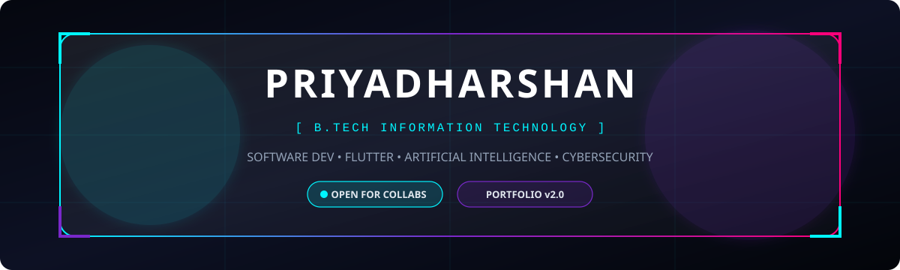

<!-- ========================================================================= -->
<!-- 🌌 PRIYADHARSHAN | FUTURISTIC GLASSMORPHISM DEVELOPER PORTFOLIO           -->
<!-- ========================================================================= -->

<div align="center">

  <!-- Self-contained Neon Glassmorphism Animated Banner -->
  <a href="https://github.com/Priyadharshan-7">
    
  </a>

  <!-- Animated Typing Tagline -->
  <a href="https://github.com/Priyadharshan-7">
    
  </a>

  <p>
    <i>"Architecting innovative software at the convergence of Artificial Intelligence, Mobile Systems, and Security."</i>
  </p>

  <!-- Profile Visitor Counter & Followers Badge -->
  <p>
    <a href="https://github.com/Priyadharshan-7">
      
    </a>
    <a href="https://github.com/Priyadharshan-7?tab=followers">
      
    </a>
  </p>

  <!-- Connect / Social Badges -->
  <p>
    <a href="https://www.linkedin.com/in/priyadharshan7" target="_blank">
      
    </a>
    <a href="mailto:priyadharshanravichandran2@gmail.com">
      
    </a>
    <a href="https://github.com/Priyadharshan-7">
      
    </a>
  </p>

</div>

---

### 🧊 01. Developer Dossier

<table width="100%">
  <tr>
    <td width="50%" valign="top">
      <h4>⚡ MISSION PROFILE</h4>
      <ul>
        <li>🎓 <b>Discipline:</b> B.Tech in Information Technology</li>
        <li>💡 <b>Engineering Philosophy:</b> High-velocity problem solving with clean architecture</li>
        <li>🔬 <b>Current Research:</b> LLM-assisted static and behavioral binary analysis</li>
        <li>🎯 <b>Immediate Target:</b> Securing software engineering roles & building scalable impact</li>
      </ul>
    </td>
    <td width="50%" valign="top">
      <h4>🔮 CORE SPECIALIZATIONS</h4>
      <ul>
        <li>📱 <b>Cross-Platform:</b> Modern Flutter & Dart reactive architectures</li>
        <li>🧠 <b>Intelligent Systems:</b> Applied ML, Vision systems & Predictive models</li>
        <li>🛡️ <b>Cyber Defense:</b> Application security, reverse engineering & threat telemetry</li>
        <li>🌐 <b>Systems:</b> Full-stack development & database normalization</li>
      </ul>
    </td>
  </tr>
</table>

---

### 🛠️ 02. Tech Stack Matrix

<div align="center">

#### 💻 Programming Languages
<p>
  
  
  
  
  
</p>

#### 📱 App & Full-Stack Web Development
<p>
  
  
  
  
</p>

#### 🧠 Machine Learning & Data Systems
<p>
  
  
  
  
</p>

#### ⚙️ Developer Tools & Environments
<p>
  
  
  
  
</p>

#### 🔬 Currently Exploring & Researching
<p>
  
  
  
</p>

</div>

---

### 🚀 03. Featured Projects Showcase

<table>
  <tr>
    <td width="50%" valign="top">
      <h3>🛡️ 01. AI-Based APK Malware Detection</h3>
      <p>An intelligent Android security analyzer combining decompilation, permission static telemetry, and LLM reasoning to identify malicious APK payloads and suspicious bytecode heuristics.</p>
      <p>
        
      </p>
      <code>Python</code> <code>Flutter</code> <code>LLMs</code> <code>Android Security</code>
      <br/><br/>
      👉 <a href="https://github.com/Priyadharshan-7"><b>Inspect Repository</b></a>
    </td>
    <td width="50%" valign="top">
      <h3>🎭 02. Real-Time Face Emotion Detection</h3>
      <p>Computer vision system powered by OpenCV and machine learning classifiers that tracks facial landmarks in real time, detecting micro-expressions and emotion sentiment indices.</p>
      <p>
        
      </p>
      <code>Python</code> <code>OpenCV</code> <code>Scikit-Learn</code> <code>Computer Vision</code>
      <br/><br/>
      👉 <a href="https://github.com/Priyadharshan-7"><b>Inspect Repository</b></a>
    </td>
  </tr>
  <tr>
    <td width="50%" valign="top">
      <h3>💼 03. Fake Job Detection Engine</h3>
      <p>A natural language processing and machine learning pipeline that inspects fraudulent online recruitment postings through textual entropy, metadata anomalies, and spam classification.</p>
      <p>
        
      </p>
      <code>Python</code> <code>NLP</code> <code>Scikit-Learn</code> <code>Classification</code>
      <br/><br/>
      👉 <a href="https://github.com/Priyadharshan-7"><b>Inspect Repository</b></a>
    </td>
    <td width="50%" valign="top">
      <h3>📱 04. Cross-Platform Flutter Innovations</h3>
      <p>Production-ready mobile applications built with reactive state management, offline-first SQLite synchronization, and sleek glassmorphic UI components.</p>
      <p>
        
      </p>
      <code>Flutter</code> <code>Dart</code> <code>Firebase</code> <code>REST APIs</code>
      <br/><br/>
      👉 <a href="https://github.com/Priyadharshan-7"><b>Inspect Repository</b></a>
    </td>
  </tr>
</table>

---

### 📊 04. Telemetry & GitHub Statistics

<div align="center">
  <table border="0">
    <tr>
      <td align="center" valign="middle">
        <a href="https://github.com/Priyadharshan-7">
          
        </a>
      </td>
      <td align="center" valign="middle">
        <a href="https://github.com/Priyadharshan-7">
          
        </a>
      </td>
    </tr>
  </table>

  <!-- Streak Stats -->
  <p>
    <a href="https://github.com/Priyadharshan-7">
      
    </a>
  </p>
</div>

---

### 🏆 05. Credentials & Milestones

<table>
  <thead>
    <tr>
      <th>Badge / Domain</th>
      <th>Certification / Milestone</th>
      <th>Issuer / Organization</th>
      <th>Verification</th>
    </tr>
  </thead>
  <tbody>
    <tr>
      <td>🎓 <b>Academics</b></td>
      <td>B.Tech in Information Technology</td>
      <td>Undergraduate Degree</td>
      <td>In Progress</td>
    </tr>
    <tr>
      <td>📱 <b>Mobile</b></td>
      <td>Flutter App Development Specialization</td>
      <td>Certification Course</td>
      <td><a href="https://www.linkedin.com/in/priyadharshan7">Verify Credential</a></td>
    </tr>
    <tr>
      <td>🧠 <b>AI / ML</b></td>
      <td>Machine Learning Foundations & Computer Vision</td>
      <td>Certification Course</td>
      <td><a href="https://www.linkedin.com/in/priyadharshan7">Verify Credential</a></td>
    </tr>
    <tr>
      <td>🛡️ <b>Security</b></td>
      <td>Cybersecurity Awareness & Threat Modeling</td>
      <td>Workshop & Hands-on Labs</td>
      <td><a href="https://www.linkedin.com/in/priyadharshan7">Verify Credential</a></td>
    </tr>
  </tbody>
</table>

---

### 🌌 06. Terminal Output

<div align="center">

```bash
priyadharshan@system:~$ ./launch_mission.sh --target="Impactful Software Engineering"
[✓] Initializing Neural Networks & Heuristic Analyzers... Done.
[✓] Deploying High-Performance Flutter Interfaces... Done.
[✓] Verifying Cyber Defense Posture... Protected.
>>> System Status: Ready to collaborate on disruptive software solutions.
```

<p>
  <i>"Code is not just instructions for machines; it is the blueprint for tomorrow's reality."</i>
</p>

<p>
  <a href="#-priyadharshan--futuristic-glassmorphism-developer-portfolio"><b>▲ Return to Top</b></a>
</p>

</div>
