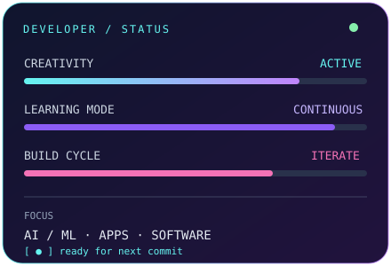

<!--
╔══════════════════════════════════════════════════════════════╗
  3D / NEON DEVELOPER DASHBOARD — GitHub Profile README
  Replace YOUR_USERNAME and the sample project links below.
╚══════════════════════════════════════════════════════════════╝
-->

  
  
  

---

## ◈ `01 / SYSTEM OVERVIEW`

<table>
<tr>
<td width="58%" valign="top">

### Hey, I'm Priyadharshan 👋

I'm an **Information Technology student** who enjoys turning ideas into useful applications and exploring how AI can make software smarter.

- 🔭 **Currently building:** AI-powered tools and developer projects
- 🧠 **Exploring:** Machine Learning, LLMs, Flutter, and full-stack development
- 🛠️ **I enjoy:** Problem-solving, experimenting, and learning by building
- 🎯 **Goal:** Grow into a strong software engineer and build products with real impact
- ⚡ **Mindset:** Learn → Build → Test → Improve

</td>
<td width="42%" valign="top">

</td>
</tr>
</table>

## ◈ `02 / TECH STACK`

### Languages

### Frameworks, tools & platforms

> **Note:** These are technologies I work with or am exploring. Update the list to match your current skill level.

## ◈ `03 / LIVE GITHUB TELEMETRY`

 

 

## ◈ `04 / CONTRIBUTION MATRIX`

The contribution snake is generated daily by GitHub Actions. After uploading this repository, make sure **Actions** are enabled and run the workflow once.

<picture>
  <source media="(prefers-color-scheme: dark)" srcset="https://raw.githubusercontent.com/YOUR_USERNAME/YOUR_USERNAME/output/github-contribution-grid-snake-dark.svg" />
  <source media="(prefers-color-scheme: light)" srcset="https://raw.githubusercontent.com/YOUR_USERNAME/YOUR_USERNAME/output/github-contribution-grid-snake.svg" />
  
</picture>

## ◈ `05 / FEATURED PROJECTS`

<!-- Replace these sample cards with your real repository names, descriptions and links. -->

<table>
<tr>
<td width="50%" valign="top">

### ◉ AI-Based Reverse Engineering Assistant
An experimental assistant concept for helping developers inspect software behavior and understand technical artifacts.

**Stack:** `Python` `AI/ML` `LLMs`

[↗ View repository](https://github.com/YOUR_USERNAME/REPO_ONE)

</td>
<td width="50%" valign="top">

### ◉ Face Emotion Detection
A computer-vision project exploring facial-expression classification and real-time detection.

**Stack:** `Python` `OpenCV` `Flask` `Scikit-learn`

[↗ View repository](https://github.com/YOUR_USERNAME/REPO_TWO)

</td>
</tr>
<tr>
<td width="50%" valign="top">

### ◉ Fake Job Detection
A machine-learning project idea for classifying suspicious job postings and helping users assess risk.

**Stack:** `Python` `Machine Learning` `NLP`

[↗ View repository](https://github.com/YOUR_USERNAME/REPO_THREE)

</td>
<td width="50%" valign="top">

### ◉ SkillProof / Developer Portfolio
A platform concept for presenting project evidence, skills, and mentor-verified learning.

**Stack:** `Full Stack` `JavaScript` `Database`

[↗ View repository](https://github.com/YOUR_USERNAME/REPO_FOUR)

</td>
</tr>
</table>

## ◈ `06 / CURRENT MISSION`

| Mission | Status |
|:--|:--|
| Strengthen DSA and programming fundamentals | `IN PROGRESS` |
| Build and deploy useful projects | `IN PROGRESS` |
| Explore AI/ML and LLM applications | `EXPLORING` |
| Improve software engineering practices | `ALWAYS ON` |

## ◈ `07 / CONNECT`

 

Designed with curiosity, caffeine, and a lot of commits. · © Priyadharshan

